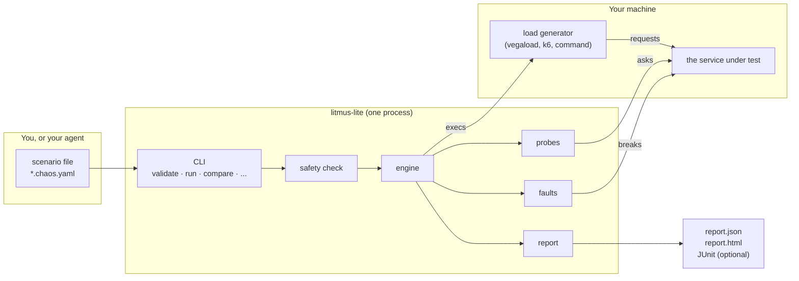
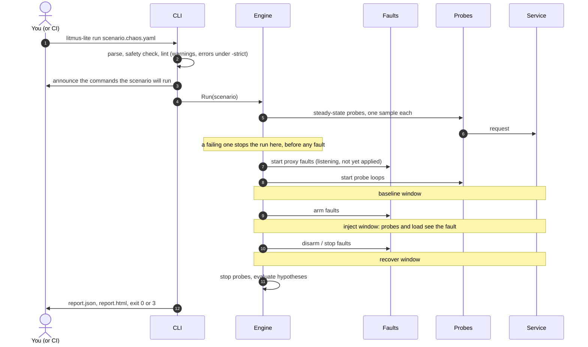
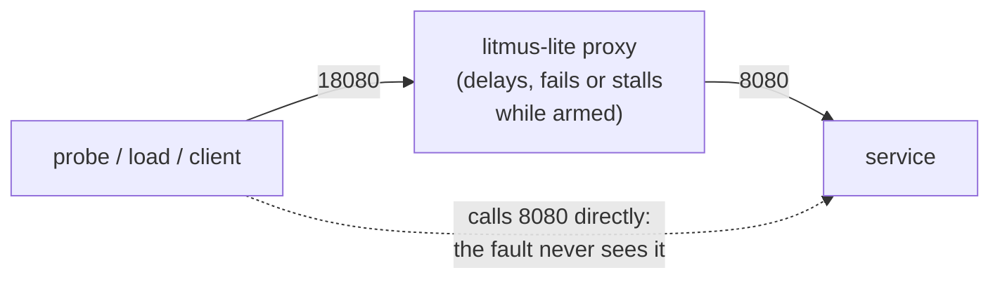
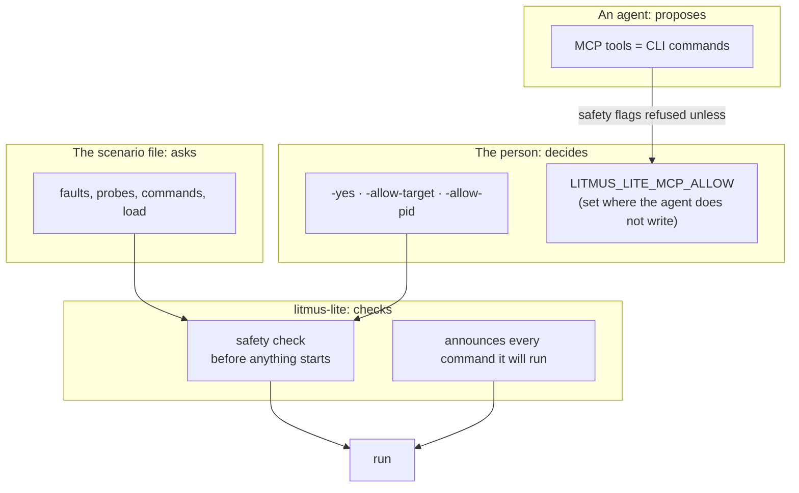

# Architecture

This is the short version: what the parts are, what happens during a run, what each part is trusted with, and why it is built this way. For the code-level version, with the interfaces and the order of things in the engine, see [internals.md](internals.md). For what a result means, see [How a run is judged](hypotheses.md).

## What it is

One static binary, `litmus-lite`. You write a scenario as a file (`*.chaos.yaml`), run it, and read a report. A scenario says what to break, what to watch, and what must still be true. Nothing needs to be installed on the target and no server needs to run.



The same CLI is the only way in. An agent uses it through MCP, which runs the same commands a person would type (see [the MCP gate](#the-mcp-gate)). There is no second code path for agents.

## The parts

| Part | Does | Does not |
| --- | --- | --- |
| **Scenario** (`internal/scenario`) | Parses and validates the file. | Run anything. |
| **Safety** (`internal/safety`) | Refuses a scenario that touches something you did not allow: a non-loopback host, a process you did not name, a long or destructive fault without `-yes`. | Know about any fault's internals beyond its params. |
| **Engine** (`internal/engine`) | Runs the timeline: baseline, inject, recover. Starts probes, faults and the load generator, rolls everything back, builds the result. | Know about HTTP reports, MCP, or any vendor. |
| **Faults** (`internal/faults`) | One plugin per kind (`http.latency`, `process.pause`, `cpu.hog`, ...). Each can start, and each can stop. | Decide when to start. The engine does. |
| **Probes** (`internal/probe`) | One sample of "is the service OK": an HTTP request or a command. | Judge. They only record. |
| **Report** (`internal/report`) | Turns samples into phases, a time series, recovery and the verdict of each hypothesis. Writes JSON, HTML, JUnit. | Run anything. |
| **Compose** (`internal/compose`) | Starts an external load generator and merges its series into the report. | Link a generator as a library. |
| **Stream** (`internal/stream`, `internal/live`) | Sends the run as events, as it happens, to a file, a URL or a browser page. | Change the result. A failing sink is a warning. |
| **MCP** (`internal/mcp`) | Exposes the CLI to an agent. | Call the engine. It runs the binary and reads its JSON. |
| **Hub** (`internal/hub`) | Ships starting-point scenarios inside the binary. | Fetch anything unless you pin a git source. |
| **move-to** (`internal/moveto`) | Writes a scenario in a neutral form, and adapters write it for other tools. | Let the engine know any of those tools exist. |

The boundaries are enforced by what each package may import. The engine does not import the MCP, report-HTML or move-to packages, and the stream package does not import the engine; the engine reaches it only through an interface it owns.

## One run



Three phases, in this order:

1. **Baseline** (`steady`). The service as it is. This is what you compare against.
2. **Inject** (`inject`). Faults are applied for their duration. Most hypotheses are judged on this phase.
3. **Recover** (`recover`). Faults are removed. The recovery hypothesis is judged on this phase: how long until the service is healthy again.

The run ends with exit code 0 when every hypothesis held, 3 when the run finished and one did not, 1 for an error and 2 for a refusal. Ctrl-C or SIGTERM rolls every fault back first and then exits 130 without a report.

## Why HTTP faults are a proxy

`http.latency`, `http.status-inject` and `http.timeout` run a small reverse proxy in the litmus-lite process. Your probes (and your load generator, or your client) call the proxy; the proxy calls your service.



It is a user-space proxy, and not packet filters or `tc`, because it needs no privileges, works the same on Linux, macOS and Windows, cannot leave a rule behind if the process is killed, and only ever touches the one address you named. The cost is that the traffic has to be pointed at it. `validate` warns when no probe calls a proxy fault's `listen` address, and `run` warns when a proxy saw no request while it was armed, since either way the hypotheses were judged on a service nothing disturbed.

The proxy speaks HTTP/1.1 on a plain TCP listener. gRPC and cleartext HTTP/2 are not supported.

## What is trusted with what



- A scenario is a request, not a permission. By default it can touch loopback addresses only, and cannot signal a process, kill, fill a disk or run longer than 60 seconds until a person adds the flag that says so.
- A scenario can run shell commands (`cmd` probes, `load.tool: command`) with your permissions. Nothing sandboxes them. litmus-lite prints every command before it runs, and you are expected to read a scenario you did not write.
- <a id="the-mcp-gate"></a>An agent cannot grant itself those permissions. The MCP server refuses `yes`, `allow-target` and `allow-pid` unless the person who set the server up named them in `LITMUS_LITE_MCP_ALLOW`.
- Nothing leaves your machine unless you set it up: a stream destination (`-stream-push`), a live-view service, a pinned hub repository or a Prometheus URL. There is no telemetry. With a live-view service configured, `run` sends the run (not usage data) to it and opens its page; `-no-live`, `LITMUS_LITE_LIVE=off` or `CI` turn that off. Credentials in fault params are never put in events or reports. The list is in [the README](../README.md#what-leaves-your-machine).

More: [SECURITY.md](../SECURITY.md).

## Why it is built this way

- **A test is a file.** A scenario an agent writes is on disk, in your repository, next to the service. You can read it, review it, run it in CI, and `git blame` it. Nothing exists only in a chat.
- **The CLI works alone, and the agent is optional.** MCP runs the same commands a person types. If something only worked through an agent, that would be a bug.
- **Hypotheses, not thresholds.** A scenario says what must still be true while it fails ("error rate under 5%", "back to healthy within 10 seconds") and the result says which of those held. A pass means every stated hypothesis held, and it is only as strong as those statements, which is why a scenario with none is flagged.
- **Load generators are run, not linked.** `vegaload`, `k6` and your own command are separate programs we start and read the output of. litmus-lite stays one small binary, and you can use the generator you already have.
- **One static binary.** It cross-compiles to Linux, macOS and Windows, and it can be dropped on a laptop or into a CI step without a runtime.
- **The engine does not know who is watching.** Streaming, the live page and reports hang off it through an interface that never blocks the run. The engine's result is the same with or without them.
- **Faults are plugins.** A new kind registers itself and does not edit the engine (see [internals.md](internals.md#adding-a-fault)).

## Where things are in the repository

```text
cmd/litmus-lite/   the CLI: flags, exit codes, notices, wiring
internal/
  scenario/        the file format, parsing, validation
  safety/          what a scenario may touch
  engine/          the run: phases, probes, faults, load, result
  faults/          one file or two per fault kind
  probe/           HTTP and command probes
  report/          phases, time series, recovery, hypotheses, JSON/HTML/JUnit
  compose/         external load generators
  stream/ live/    events, sinks, recordings, serve, the live page
  mcp/             MCP server over the CLI
  hub/             embedded starting-point scenarios
  moveto/          neutral IR and adapters
failpoint/         Go SDK that an app can embed for in-process faults
examples/          runnable examples (cashier is the quick start)
docs/              this documentation
```
