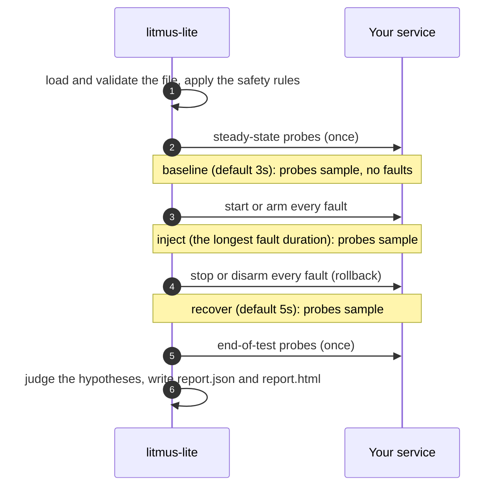

# How a run works

`litmus-lite run FILE` (or the `run_test` MCP tool, which runs exactly that) goes through the same steps every time.

## Before anything is injected

1. **Load and validate.** The file is parsed and checked: required keys, readable values, known fault kinds. Unknown keys are warnings (errors with `-strict`). Anything that fails here stops the run with exit code `1`.
2. **Apply the safety rules.** A non-loopback target, a process to signal, an irreversible fault or a long one each need a flag. Without it the run is refused with exit code `2`. See [Safety](safety.md).
3. **List what it will run.** If a probe or the load generator runs a command, it is printed, in quotes, before anything runs.
4. **Check the steady state.** Each `steadyState` probe, and each probe with `mode: SOT`, is sampled once. If one fails, the service was not healthy to begin with, so the run stops and nothing is injected.

## The three phases

**Baseline** (`baseline`, default `3s`). Probes sample a healthy service. This is the "before" in the report.

**Inject.** Every fault starts at once and stays on for its `duration`; the window lasts as long as the longest fault. HTTP proxies are started before the baseline so that probes can already go through them, and are only *armed* now. If a load generator is configured, it starts here too (or with the baseline, with `load.start: baseline`).

**Recover** (`recover`, default `5s`). Every fault is undone, and probes keep sampling to see how fast the service comes back.

Then end-of-test probes (`mode: EOT`) run once, and the run is judged.

!!! info "A sample belongs to the phase it started in"
    A request that starts just before the faults arm and fails because of them counts as baseline. Keep probe timeouts short compared with the phases.

## Rollback

Every fault is undone when the run ends, when it fails part-way, and when it is interrupted with Ctrl-C or `SIGTERM` (exit code `130`). Each fault's rollback result is in the report. The only thing litmus-lite cannot undo is what happens if it is killed outright (`SIGKILL`, a power cut): see the limits on the [Safety](safety.md#what-safety-does-not-cover) page.

## The verdict

Each [hypothesis](hypotheses.md) is judged on what the probes saw during the inject window, or, for `recovery`, after it. The run passes when every hypothesis holds.

| Exit code | Meaning |
| --- | --- |
| `0` | the run finished and every hypothesis held |
| `3` | the run finished and at least one hypothesis did not hold |
| `1` | the scenario or the run could not proceed (invalid file, service unhealthy at the start, a fault failed to start) |
| `2` | a usage error, or a refusal by the safety rules |
| `130` | interrupted; every fault was rolled back first |

`3` is a finding about your service, not a failure of the tool. In CI, treat it as a failed test.

## Warnings worth reading

A run can pass and still warn you that it proved less than it seems. Warnings are printed, kept in the report, and shown by the agent:

- **A key nothing reads.** `dealy: 800ms` injects no delay. Use `-strict` to make this an error.
- **A probe that bypasses the proxy.** HTTP faults only affect requests sent to their `listen` address.
- **A proxy that saw no requests.** Nothing went through the fault, so the hypotheses were judged on an undisturbed service.
- **No hypotheses.** A run with nothing to judge passes trivially.
