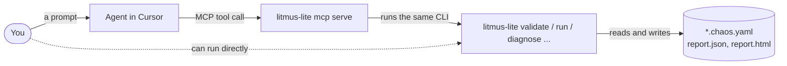

# Working with an agent

litmus-lite is **agent-native, not agent-mandatory**. An agent can turn a sentence into a scenario, run it and explain the result. What it leaves behind is an ordinary file in your repository that runs the same without it.

## How it fits together



Every MCP tool runs one CLI command, with `-output json`, and returns what it printed. There is no agent-only path: anything the agent did, you can do in a terminal. [The tools](../reference/mcp.md).

## Set up

=== "Cursor"

    ```bash
    cd path/to/your/project
    litmus-lite init
    ```

    This writes `.cursor/mcp.json` (the server), `.cursor/rules/litmus-lite.mdc` (the conventions the agent follows) and `.mcp.json` (for Claude Code). Open the project in Cursor, check **Settings > Tools & MCP** shows `litmus-lite` as on, and start a new Agent chat.

=== "Claude Code"

    ```bash
    litmus-lite init -editor claude-code
    ```

=== "Another MCP client"

    Register a stdio server whose command is the absolute path of the binary, with the argument `mcp serve`:

    ```json
    { "mcpServers": { "litmus-lite": { "command": "/usr/local/bin/litmus-lite", "args": ["mcp", "serve"] } } }
    ```

Re-run `init` after you move or upgrade the binary: the entry records its absolute path.

## Three rules

They are a good way to check that an agent is doing the right thing.

1. **A test is a file, never chat state.** Every scenario the agent makes is a `*.chaos.yaml` on disk, beside the service. If it only describes one, ask it to write the file.
2. **The CLI works alone.** You can leave the editor and run the file in a terminal or in CI.
3. **The agent cannot consent for you.** `yes`, `allow-target` and `allow-pid` confirm a destructive or out-of-scope action, so the MCP server refuses them unless you enabled them once. [How](../concepts/safety.md#the-agent-cannot-consent-for-you).

## Prompts that work

Each pairs the prompt with the CLI the agent runs underneath.

=== "In Cursor"

    !!! quote "A slow dependency"
        Add 800 ms of latency to the API on port 8080 for 12 seconds and tell me whether it copes and how fast it recovers.

    !!! quote "Errors"
        Make the API return 503 for half the requests for 10 seconds and tell me whether errors stay bounded. Validate with strict checking first.

    !!! quote "An existing scenario"
        Validate `checkout/http-latency.chaos.yaml` with strict checking, run it, and tell me which hypotheses held.

    !!! quote "Why did it fail?"
        Diagnose `report.json` and tell me what to look at first.

    !!! quote "Before and after"
        Compare `baseline.json` and `report.json` and go through steady, inject and recover. Do not invent a score.

    !!! quote "Load and chaos"
        Send the same traffic through the API while it is being slowed down, and tell me what those users experienced.

        Needs a load generator: see [Load and chaos together](load-and-chaos.md).

=== "In a terminal"

    ```bash
    # A slow dependency
    litmus-lite hub import http.latency -beside ./api
    $EDITOR api/http-latency.chaos.yaml
    litmus-lite validate -strict api/http-latency.chaos.yaml
    litmus-lite run api/http-latency.chaos.yaml

    # Errors
    litmus-lite hub import http.status-inject -beside ./api

    # Why did it fail?
    litmus-lite diagnose report.json

    # Before and after
    litmus-lite compare baseline.json report.json
    ```

## What a good answer looks like

After a run, a good agent answer:

- names the file it wrote or ran, so you can open it;
- says **passed** or **failed** in terms of the hypotheses by name, with the observed values;
- says how long recovery took;
- mentions every warning the run printed, especially "saw no requests" or "bypasses the proxy";
- points you at `report.html`;
- if a safety argument was refused, says so and gives you the command, instead of working around it.

A finished run that did not pass is a finding about your service, not a tool error. The agent gets it the same way as a pass.

## When it goes wrong

| You see | What to do |
| --- | --- |
| The `litmus-lite` tools are not listed | **Settings > Tools & MCP**: toggle `litmus-lite` on, or reload the window. Re-run `litmus-lite init` if you moved the binary. |
| The agent describes a scenario but wrote nothing | Ask it to write the `*.chaos.yaml` file, then validate it. |
| A latency run passed but p95 did not move | The probes call the service directly. Ask the agent to point them at the proxy's `listen` address. |
| "The `allow-pid` argument is refused" | Working as intended. Run the command yourself, or enable it once: `litmus-lite init -env LITMUS_LITE_MCP_ALLOW=allow-pid`, then reload. |
| The agent quotes a "resilience score" | There is none. Ask it to answer from the hypotheses and the phases. |

## Check the server

```bash
litmus-lite mcp eval
```

runs the server against its fixtures, including the refusals. Run it from a clone of this repository.

For a longer, prompt-by-prompt session with a two-process app, process faults and consent, see the [agent walkthrough](agent-walkthrough.md).
