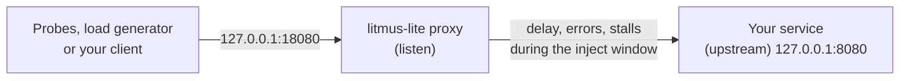

# HTTP faults

Slow responses, error responses and hanging requests are the failures most services meet first. litmus-lite injects all three with a small proxy, with no change to your code.

## How the proxy works



The proxy starts before the baseline and forwards traffic untouched until the inject window, so the baseline is measured through the same hop. It applies the fault during the window, then passes traffic through again during recovery.

!!! warning "Send traffic to `listen`, not to your service"
    Only requests that go through the proxy are affected. A probe that calls `:8080` directly sees a healthy service and the run passes for the wrong reason. `validate` warns about a probe that bypasses the proxy, and `run` warns when the proxy saw no requests at all.

## Latency

=== "In Cursor"

    !!! quote ""
        Add 800 ms of latency, with up to 100 ms of jitter, to the API on port 8080 for 12 seconds. Errors must stay under 5% and it must recover within 5 seconds.

=== "In a terminal"

    ```bash
    litmus-lite hub import http.latency -beside ./api
    ```

    Edit the addresses, the delay and the hypotheses:

    ```yaml
    faults:
      - name: slow-api
        kind: http.latency
        duration: 12s
        params:
          listen: "127.0.0.1:18080"
          upstream: "127.0.0.1:8080"
          delay: 800ms
          jitter: 100ms
    probes:
      - name: orders
        url: http://127.0.0.1:18080/api/orders
        timeout: 2s
    hypotheses:
      - { name: errors stay low, metric: error_rate, operator: "<", value: 5% }
      - { name: recovers, metric: recovery, operator: "<=", value: 5s }
    ```

**What to expect:** p95 rises by about the delay during the inject window. If the probe's `timeout` is shorter than the delay, samples fail instead, which shows up as errors. To judge latency directly, add a hypothesis such as `p95 < 1.5s`.

## Error responses

=== "In Cursor"

    !!! quote ""
        Make the API return 503 for 30% of requests for 10 seconds and tell me whether errors stay under 40%. Validate with strict checking first.

=== "In a terminal"

    ```bash
    litmus-lite hub import http.status-inject -beside ./api
    ```

    ```yaml
    faults:
      - name: flaky-api
        kind: http.status-inject
        duration: 10s
        params:
          listen: "127.0.0.1:18080"
          upstream: "127.0.0.1:8080"
          percent: 30
          code: 503
    ```

**What to expect:** about `percent` of requests through the proxy fail with `code`. Use it to check retries, fallbacks and error budgets. A client with retries in front of the proxy should keep the error rate well below `percent`.

You can also add sparse errors to a latency fault with `statusOverride: { percent: 5, code: 500 }`.

## Timeouts

=== "In Cursor"

    !!! quote ""
        Make requests to the API hang for 3 seconds, for 8 seconds, and tell me whether callers time out cleanly and the service recovers.

=== "In a terminal"

    ```bash
    litmus-lite hub import http.timeout -beside ./api
    ```

    ```yaml
    faults:
      - name: stall
        kind: http.timeout
        duration: 8s
        params:
          listen: "127.0.0.1:18080"
          upstream: "127.0.0.1:8080"
          timeout: 3s
    probes:
      - name: orders
        url: http://127.0.0.1:18080/api/orders
        timeout: 1s      # shorter than the stall: a hung call is a failed sample
    ```

**What to expect:** a drop in availability rather than a latency curve. Give probes a `timeout` shorter than the stall so a hung request counts as a failure.

## Testing a real client path

Probes tell you what *a* client sees. To test what *your* client does (its timeouts, retries and circuit breakers), point that client at the proxy for the run: set the dependency's address in your service's config to `127.0.0.1:18080`, and probe your service's own endpoint. Then the fault sits between your service and its dependency, which is usually what you want to know.

## Limits

- HTTP/1.1 over plain TCP only. gRPC, h2c and `https://` upstreams are not supported yet.
- Keep `listen` on loopback.
- A non-loopback `upstream` needs `-allow-target`.

Parameters in full: [Faults reference](../reference/faults.md#http-faults).
