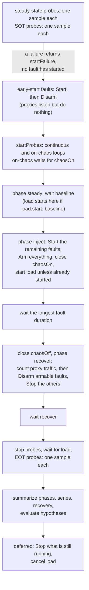

# Internals

For people changing the code. [architecture.md](architecture.md) is the overview; this page is the detail: how the engine is put together, what a fault must implement, how a result is computed, and a checklist for adding a fault. Names here are the real ones, so search for them.

## The path of `run`

`cmdRun` in `cmd/litmus-lite/main.go` does these in order, and each step can stop the run before the next:

1. `scenario.Load`: parse and validate the file. Exit 1 on error.
2. `safetyFromFlags` and `safety.Check`: refuse anything outside what the flags allow. Exit 2.
3. `lintScenario`: collect warnings (unknown keys and params, a scenario with no hypotheses, a proxy fault no probe calls). `-strict` turns them into an error, exit 1. They are printed now, and handed to the engine in `Options.Warnings` so they head `Result.Warnings`.
4. `printCommandNotice(commandsToRun(sc))`: announce every command the scenario will execute.
5. Stream and live setup (`runStream.setup`). A destination that is refused exits 2 here, before anything runs.
6. `signal.NotifyContext` for SIGINT and SIGTERM, then `engine.Run`.
7. A cancelled run prints "faults rolled back, no report written" and exits 130. Otherwise write JSON, HTML and optional JUnit, append to the audit log, and exit 0 (all hypotheses held) or 3 (finished, one did not).

`validate` runs steps 1 to 3 and nothing else. MCP's `validate_scenario` and `run_test` run the same binary, so they get the same steps.

## The engine

`engine.Run` wraps `engine.run` and does one thing the inner function must not: it makes sure the emitter sees exactly one of `Finished` or `Failed`, on every exit path, after faults have been rolled back.

### State and goroutines

`run` has one mutex, `mu`, guarding `samples` (every probe sample) and `res.Warnings`. Everything that appends to either takes it.

| Goroutine | Started by | Ends when |
| --- | --- | --- |
| one per continuous or on-chaos probe | `startProbes` | `stopProbes` is closed, the context is cancelled, or (on-chaos only) `chaosOff` closes |
| the live-point ticker | `livePoints.begin`, only when an emitter is set | `live.end()` |
| the load generator | `startLoad` | the generator exits, or `loadCtx` is cancelled by the deferred cleanup |
| each fault's own, if any | its `Start` | its `Stop` |

`haltProbes` closes `stopProbes` once (`sync.Once`) and waits for the probe goroutines. It is called both at the normal end of the run and from the deferred cleanup, so an early return cannot leave probes running.

### Order of events



Things that are easy to get wrong here:

- **The inject window is one window.** Its length is the longest `duration` among the faults, and every fault ends at that moment. A shorter `duration` on one fault does not end it earlier.
- **Faults that are `EarlyStarter` and `Armable`** (the three `http.*` kinds) are started before the baseline and disarmed at once, so that probes can already use the listen address in the baseline and recover phases. They are armed at inject, disarmed (not stopped) at the end of it, and stopped only in the deferred cleanup. `stopped[i]` records which were stopped in the main flow so the cleanup does not stop them twice.
- **A fault that is not `Armable`** is started at the beginning of inject and stopped at the end of it.
- **Deferred rollback is the safety net.** The `defer` registered before the first fault starts stops everything in `running`, records `events[i].Rollback`, and announces any fault that had started and not ended. Every `return` after it is covered. If you add a path that can start something, it must append to `running` so this sees it.
- **Steady-state probes fail the run early**, with `startFailure`: the probe's name, where it looked (method and URL without credentials or query) and the first line of why. A command probe's command is never repeated in the message, because it may hold a secret.

### Probes and phase attribution

`probe.Once` makes one sample: `At` is when it started, `Latency` how long it took, `OK` whether it passed (the expected status, 200 unless `expect.status` says otherwise, then any body assertions; or command exit 0). Default timeout is 2 seconds.

A sample belongs to the phase in which it **started**, whatever time it ended. `report.Summarize` uses `inRange(s.At, from, to)`, and `from`/`to` are the instants the engine recorded at each boundary. So a slow request that began in inject and finished in recover counts as inject. This is what makes a latency fault show up in the inject phase even though its responses arrive late.

Modes:

| Mode | Samples |
| --- | --- |
| `continuous` (default) | all the time, from the start of probes until they are stopped |
| `on-chaos` | one sample at once when faults are armed, then on the interval until `chaosOff`; never after the window closed (the inner `select` on `off` stops a tick that raced with the close) |
| `SOT` | one sample before any fault; a failure aborts the run |
| `EOT` | one sample after the recover window |

### Hypotheses

`report.HypothesisEval(h, injectPhase, recoveryInfo)` returns a `HypothesisVerdict`. The rules that matter:

- `error_rate`, `availability`, `p50`, `p95`, `p99` and `rps` are read from the **inject** phase. `recovery` is read from `report.Recovery`.
- No samples is not a pass. `NoData` is set and `Passed` is `h.AllowNoData`, which defaults to false.
- `recovery` is the time from the end of inject to the first of three healthy samples in a row. If the run ended without that, the verdict is "not recovered" and it fails; the time to the last sample is never reported as a recovery time.
- Units are strict: a limit is parsed by `Hypothesis.Limit()`, and `validate` refuses a unit that does not fit the metric. An invalid limit never passes.
- `Result.Passed` is true only when every verdict passed. With no hypotheses it is trivially true, which is why `lintScenario` warns about it.

### The result

`report.Result` is the single value everything else is built from: the JSON and HTML, the JUnit file, the stream's final event, and `compare`. Its `SchemaVersion` is `report.SchemaVersion` (currently 2). The rule, stated at the constant: a later version only adds fields; removing or renaming one is a new number, and a reader refuses a number it does not know. If you change the JSON, update that comment's table and the readers.

`BucketPoint` is the one function that builds a point of the time series, for one one-second bucket. The final series (`BucketSeries`) and the live `point` events both call it, so a live point and the final point are the same number. Keep it that way.

## Faults

### The contract

`internal/faults/fault.go`:

```go
type Injector interface {
    Name() string
    OS() []string // empty means all
    Validate(f scenario.Fault) error
    Start(ctx context.Context, f scenario.Fault) (Running, error)
}

type Running interface {
    Intensity() float64 // the injected signal, for the overlay: ms of delay, percent of errors
    Stop() error
}
```

Optional interfaces, each looked up with a type assertion by the engine:

| Interface | Meaning | Who uses it |
| --- | --- | --- |
| `EarlyStarter` | `EarlyStart() bool`: start before the baseline | engine |
| `Armable` | `Arm()`, `Disarm()`: listening, but apply the fault only while armed | engine |
| `ParamDeclarer` | `ParamKeys() []string`: the params the fault reads, so a typo (`dealy`) is a warning (an error under `-strict`) | `faults.Lint` |
| `TrafficCounter` | `Requests() int64`: how many requests it saw while armed | engine, at the end of inject |

Rules for an implementation:

- `Start` must leave nothing behind if it returns an error, and `Stop` must be safe to call once after a successful `Start` even if the fault half-worked. Rollback is the point of the tool.
- `Validate` is called before the run (by `validate` and by the engine) and must reject what `Start` would fail on late, for example an unparsable duration. It must not touch the system.
- New kinds should implement `ParamDeclarer` and reject unknown keys. Existing kinds only warn, for compatibility.
- A fault that acts on a process, a container or a host path must be covered by `safety.Check` (see below), not rely on its own check.
- Keep OS-specific code in files with build tags (`process_unix.go`, `process_windows.go`) so the package builds for all three systems; CI vets all of them.
- Register in `init()` in `fault.go` (`Register(yourFault{})`). That is the only edit outside your file, and the engine does not change.

### The HTTP proxy

`httpproxy.go` is one implementation behind three kinds (`http.latency`, `http.status-inject`, `http.timeout`). `startHTTPProxy` builds a `httputil.ReverseProxy` to the upstream and wraps it in a handler that, while `armed`, counts the request and then applies in this order: a stall (`timeout`), a delay with jitter (`delay`, `jitter`), and a probabilistic injected status (`percent`, `code`). While disarmed it forwards untouched. `armed` and `requests` are atomics; the handler runs on the server's goroutines.

`trafficlint.go` is the static twin of `TrafficCounter`: `lintTraffic` warns when no HTTP probe calls a proxy fault's `listen` address. It stays silent when the scenario has a load generator or a command probe, since those can reach the proxy in ways it cannot see.

## Safety

`safety.Check(sc, opt)` runs before anything starts, from `run`, `validate` and `export job`. For each fault it checks that:

- a kind that needs `-yes` has it (`process.kill`, `disk.fill`);
- an `upstream`, `listen`, failpoint `url`, probe URL and `target.baseURL` are loopback, or in `-allow-target` (a `.svc` name also needs `-yes`);
- a process fault names a PID that is in `-allow-pid`;
- no duration exceeds `DefaultMaxDuration` (60 s) unless `-yes`.

The allowed PIDs travel to the faults in the context (`safety.WithAllowPIDs`), and the process faults check again before they signal, so the check cannot be skipped by a different caller.

### The MCP gate

`internal/mcp/tools.go`. The MCP server must not call the engine. `runTool` finds the CLI binary (`resolveCLI`), builds argv from the tool's arguments (`cliArgs`), runs it, and returns its stdout and stderr separately so a note on stderr cannot corrupt the JSON. Exit code 3 is a result, not a tool failure.

`checkSafetyArgs` runs first. If the call carries `yes`, `allow-target` or `allow-pid` and the server's `LITMUS_LITE_MCP_ALLOW` does not list it, nothing is run and the refusal says how a person enables it. `get_results` is the one tool without a CLI command; it reads only a file that is a litmus-lite report (`readReport`), and a test checks that every other tool has a CLI behind it (`toolsHaveCLI`).

If you add an MCP tool, it must map to a CLI command a person can type, and any flag that confirms a risk must be added to `safetyFlagNames`.

## Streaming

`stream.Recorder` implements `engine.Emitter`. The engine only knows that interface, and a nil emitter means off.

- Every sink gets its own `runner` with a bounded `queue` in front of it. `push` never blocks. Lifecycle events are always kept; when the buffer is full, samples are dropped first, then points.
- A sink whose `Write` fails is dead for the rest of the run, and that becomes a warning. It never changes the result, reports or exit code.
- Sinks can implement `Flusher` (batching), `Aborter`, `Drainer` and `Warner` to take part in the end-of-run handshake.
- Event format v1 (`docs/stream/schema/v1.json`) is frozen: add optional fields or new types only. `stream.Redact` masks credential-looking keys in fault params at any depth; `RedactedScenarioYAML` does the same for the scenario text.
- `stream` must not import `engine`. A test keeps each fixture in `docs/stream/fixtures/` equal to what `stream from-report` writes.

## Adding a fault

A checklist. A change that follows it should be reviewable without a conversation.

1. **Pick the kind name**: `area.verb` in the same style (`docker.pause`).
2. **Write `internal/faults/<name>.go`**: the type, `Name`, `OS`, `Validate`, `Start`, `ParamKeys`, and a `Running` whose `Stop` fully undoes it. Add `Register(...)` in `fault.go`'s `init`.
3. **Safety**: if it touches a process, container, disk or non-loopback host, add the rule to `internal/safety/safety.go` (and `needsYes` if it is destructive), and test the refusal.
4. **Tests next to the code**: a `Validate` table, a start-and-stop test that proves the system is restored, and the failure of `Start` leaving nothing. Run `go test -race`.
5. **Platform**: if it is OS-specific, use build-tagged files, set `OS()`, and run `GOOS=windows go vet ./...` and `GOOS=linux go vet ./...`.
6. **A hub template** in `internal/hub/hub.go` if it is a common starting point. It must have hypotheses (`TestShippedScenariosHaveNoWarnings` fails without them) and use only addresses in the safe set.
7. **Docs**: a row in the faults table in `README.md`, an entry in [`cookbooks/fault-catalog.md`](cookbooks/fault-catalog.md), and, if it adds anything the format has not seen, [hypotheses.md](hypotheses.md).
8. **MCP and move-to**: nothing to do for MCP (it runs the CLI). For `move-to`, add the mapping to the IR only if the fault has a neutral equivalent.
9. **Verify**: `gofmt -l .`, `go vet ./...`, `go test -race -count=1 ./...`. Then deliberately break your implementation, for example by making `Stop` a no-op, and confirm a test fails. A test that cannot fail does not protect anything.

## Testing conventions

- Tests live next to the code. `cmd/litmus-lite` tests drive the real command functions through `run2(t, args...)`, which returns the exit code, stdout and stderr; `writeScenario` and `inTempDir` set up a scenario file.
- Engine tests use short scenarios (`modesScenario`) against an in-process `httptest` server, with `freeAddr` for a port nothing listens on. They are real-time tests, so keep windows to a few hundred milliseconds and assert on what happened, not on exact timings.
- A user-visible warning or refusal gets a test of its exact claim (what it names, which exit code), and every such test is worth breaking the code once to see it fail.
- `TestShippedScenariosHaveNoWarnings` runs the lints over every `examples/*/*.chaos.yaml`, the stream fixture sources and the hub templates, so an example that teaches a mistake fails CI.
